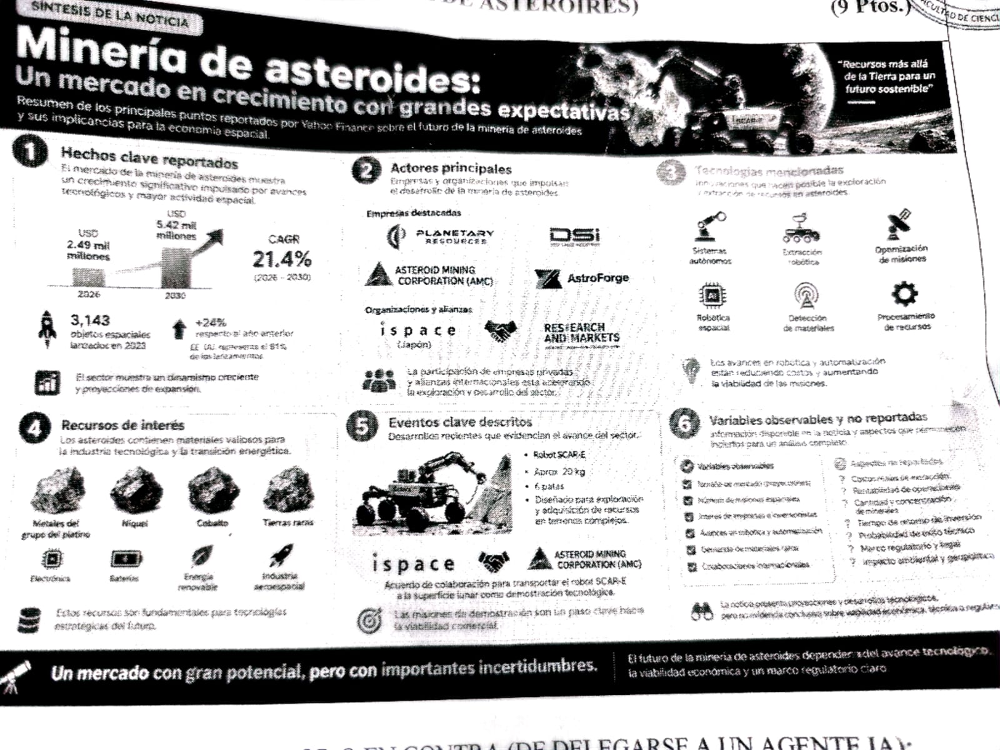
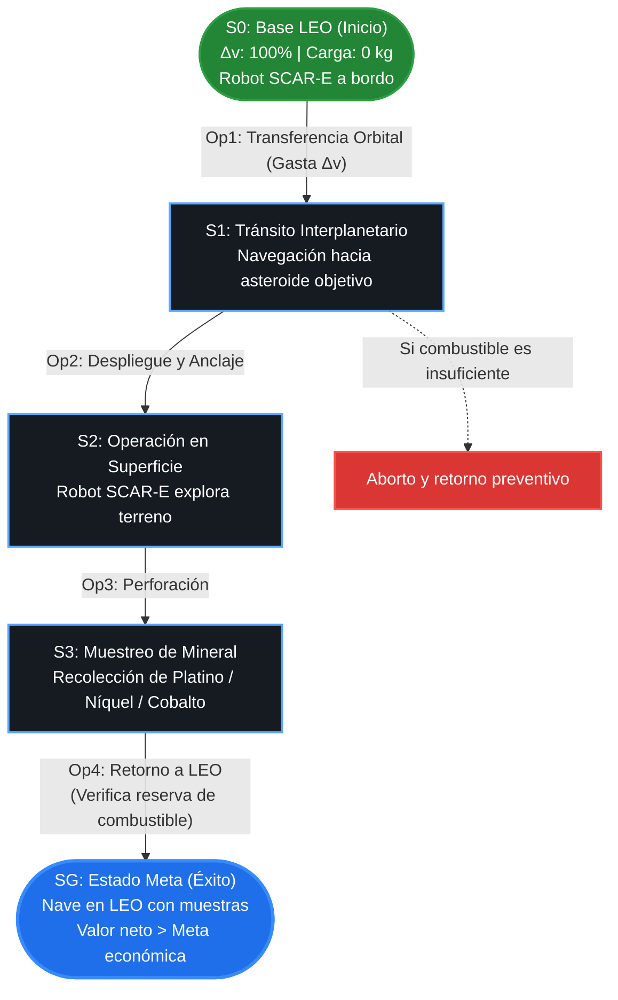
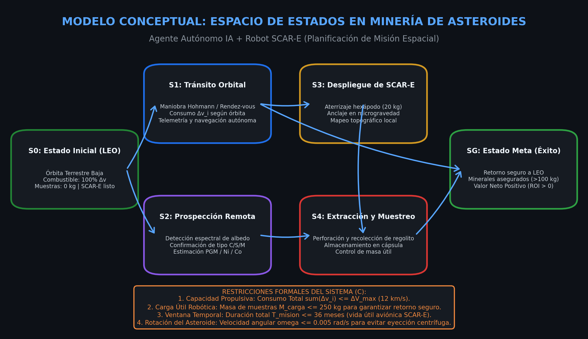

# Challenge 1: Pipeline de Machine Learning

## Caso Asignado: Minería de Asteroides

**Institución:** Universidad Peruana Cayetano Heredia (UPCH)  
**Curso:** Machine Learning  
**Docente:** Yannick Patrick Carrasco Merma  
**Unidad:** Fundamentos de Machine Learning  
**Estudiante:** Leonardo Javier Nunton Fajardo  

---

## Enlaces Directos a los Pipelines en Google Colab

| Pipeline | Descripción | Cuaderno Interactivo |
| :--- | :--- | :---: |
| **Pipeline 1: Razonamiento y Búsqueda** | Espacio de estados y comparación de algoritmos de búsqueda (**A\*, BFS, DFS**) para planificación óptima de misión espacial. | [](https://colab.research.google.com/github/tu-usuario/challenge-upch-mineria-asteroides/blob/main/notebooks/01_pipeline_busqueda_estados.ipynb) |
| **Pipeline 2: Predicción y Visualización** | Pipeline completo de Machine Learning con **Modelo de Regresión** para predecir el valor económico de asteroides y gráficos interpretativos (Uso de IA como apoyo para graficar). | [](https://colab.research.google.com/github/tu-usuario/challenge-upch-mineria-asteroides/blob/main/notebooks/02_pipeline_modelo_regresion.ipynb) |

---

## 1. Presentación del Caso y Problema

### 1.1. Contexto del Caso

El caso asignado corresponde al sector de **Minería de Asteroides**, presentado en la siguiente infografía:



En el material se destacan hechos como la proyección de crecimiento del mercado (de 2.49 a 5.42 mil millones de USD al 2030) y el interés comercial en minerales estratégicos (metales del grupo del platino, níquel y cobalto). Además, se muestran avances tecnológicos concretos, como el robot hexápodo **SCAR-E** (de aprox. 20 kg) diseñado para operar y adquirir recursos en superficies irregulares.

Sin embargo, el punto 6 del caso señala un contraste fundamental: mientras que variables macro como el mercado o el número de misiones son observables, **los aspectos determinantes para la viabilidad de un proyecto —costos reales de extracción, concentración real de minerales, retorno de inversión y probabilidad de éxito técnico— no están reportados y son inciertos**.

### 1.2. Formulación del Problema

Lanzar una misión espacial de exploración y extracción involucra presupuestos millonarios y márgenes de error mínimos. A partir del caso, el problema a resolver se divide en dos preguntas clave:

1. **Selección del objetivo:** ¿Cómo estimar de manera confiable el valor o retorno económico neto de un asteroide antes de enviar una misión, usando solo observaciones remotas preliminares (tamaño, albedo o tipo espectral)?
2. **Planificación de la misión:** ¿Cuál es la secuencia óptima para explorar y extraer recursos en los asteroides candidatos, maximizando el mineral recolectado sin agotar el combustible ni exceder el tiempo de viaje?

### 1.3. Justificación del Uso de IA y Machine Learning

El problema presenta una complejidad que hace inviable resolverlo mediante cálculos estáticos o intuición manual:

- **Machine Learning (Regresión):** Permite estimar una variable numérica continua (el valor económico neto) a partir de los datos que sí son observables desde telescopios. El modelo aprende los patrones para jerarquizar los asteroides más prometedores antes de invertir en una misión, reduciendo la incertidumbre económica.
- **Inteligencia Artificial (Búsqueda en Espacio de Estados):** Permite plantear el vuelo y las actividades del robot como un grafo de estados y acciones. Mediante algoritmos de búsqueda informada como A*, el sistema evalúa sistemáticamente las posibles rutas para encontrar el camino con menor consumo de combustible y con garantía de retorno seguro a la Tierra.

---

## 2. Espacio de Estados y Modelo Conceptual

Siguiendo la metodología de representación vista en clase , antes de aplicar cualquier algoritmo de búsqueda necesitamos estructurar el problema para que la IA pueda entenderlo. Esto se define mediante los siguientes elementos:

### 2.1. Componentes de la Representación Formal

#### 1. ¿Dónde estamos? — Estado Inicial ($S_0$)

Es la situación de partida antes de iniciar las operaciones:

- **Ubicación:** Órbita Terrestre Baja (LEO - *Low Earth Orbit*).
- **Combustible propulsivo:** 100% disponible (12.5 km/s lo tomamos como dato).
- **Carga de mineral:** 0 kg recolectados (robot a bordo listo para despliegue).
- **Tiempo de misión:** Mes 0.
- **Historial:** Ningún asteroide visitado.

#### 2. ¿Qué situaciones puede adoptar el sistema? — Espacio de Estados ($S$)

Un estado representa una fotografía del sistema en un instante de tiempo. Para que la IA tome decisiones, cada estado se define como una tupla con 5 variables:

$$\text{Estado } s = (\text{Ubicación}, \Delta v_{\text{restante}}, \text{Carga}, \text{Tiempo}, \text{Visitados})$$

**¿Para qué sirve cada variable?**

- **Ubicación:** Indica la posición orbital actual. Le indica a la IA desde dónde debe calcular el siguiente viaje.
- **$\Delta v_{\text{restante}}$ (Combustible):** Velocidad disponible en km/s. Es el recurso más crítico de la nave; si llega a cero lejos de la Tierra, la misión se pierde.
- **Carga (kg):** Cantidad de material extraído por el robot SCAR-E. Sirve para saber si ya se alcanzó la meta de mineral.
- **Tiempo (meses):** Duración acumulada de viaje y operaciones. Permite controlar la vida útil de los equipos.
- **Visitados:** Lista de asteroides ya explorados para evitar visitas redundantes en el algoritmo.

#### 3. ¿Qué podemos hacer? — Acciones ($A$)

- **Acción 1: Transferencia Orbital a un Asteroide ($\text{Viajar}$):** Consume una cantidad de combustible proporcional a la distancia orbital y suma meses de tránsito.
- **Acción 2: Prospección y Muestreo ($\text{Extraer}$):** El robot SCAR-E desciende en la superficie del asteroide, recolecta testigos de mineral (platino, níquel, cobalto) y los almacena en la cápsula, incrementando la carga útil.
- **Acción 3: Maniobra de Retorno a la Tierra ($\text{Retornar}$):** Ejecuta el impulso propulsivo de regreso hacia LEO para concluir la misión.

#### 4. ¿Qué no podemos hacer? — Restricciones ($C$)

- **Reserva de retorno seguro:** En todo momento se debe cumplir:
  $$\Delta v_{\text{restante}} \ge \Delta v_{\text{retorno a LEO}}$$
  *¿Para qué sirve?* Evita que la nave gaste todo su combustible en asteroides lejanos y se quede sin propulsión para volver a la Tierra.
- **Límite de carga útil ($M_{\text{carga}} \le 250\text{ kg}$):** Capacidad máxima que la cápsula puede reingresar a la atmósfera sin comprometer su integridad térmica.
- **Límite de tiempo ($T_{\text{misión}} \le 36\text{ meses}$):** Tiempo máximo de operatividad de los sistemas electrónicos y baterías del robot en el espacio profundo.

#### 5. ¿A dónde queremos llegar? — Estado Objetivo ($G$)

Situación final deseada:

- La nave ha retornado a la base (**LEO**).
- La cantidad y calidad de mineral recolectado supera la meta económica mínima establecida (por ejemplo, valor neto $> 850$ millones de USD).
- El combustible restante es mayor o igual a cero.

#### 6. ¿Cuál es el mejor camino? — Función de Costo y Heurística en A* ($f$)

Para guiar la búsqueda de la ruta óptima utilizamos la función de evaluación:

$$f(n) = g(n) + h(n)$$

**¿Para qué sirve cada término?**

- **$g(n)$ (Costo real acumulado):** Es la suma de $\Delta v$ (combustible) que la nave ya consumió desde LEO hasta el estado actual. Mide el gasto efectivo realizado.
- **$h(n)$ (Heurística o costo estimado restante):** Es una estimación admisible (optimista) del combustible mínimo necesario para retornar a LEO cumpliendo la meta económica.
- **$f(n)$ (Prioridad total):** Permite que el algoritmo A* explore primero los caminos más prometedores y de menor consumo, descartando de inmediato las trayectorias costosas o inviables.

---

### 2.2. Representación Visual del Espacio de Estados

El siguiente diagrama muestra el flujo conceptual de estados desde la partida en LEO hasta el retorno exitoso con muestras:





---

## 3. Pipeline de Razonamiento, Búsqueda y Resultados

Implementado en el cuaderno interactivo: [`notebooks/01_pipeline_busqueda_estados.ipynb`](notebooks/01_pipeline_busqueda_estados.ipynb)

### Resumen del Flujo de Razonamiento

1. **Entorno de Simulación:** Modelado de asteroides cercanos a la Tierra (NEOs basados en Bennu, Ryugu, Eros, Apollo, Amun y Apophis) con distancias en UA, requerimientos de $\Delta v$, masa estimada y valor mineral esperado.
2. **Matriz de Costos de Maniobra:** Cálculo de la energía cinética de cambio orbital ($\Delta v_{i,j}$) entre cualquier par de asteroides y respecto a la Tierra.
3. **Algoritmos Implementados:**
   - **Búsqueda A\*:** Utiliza la función de costo $f(n) = g(n) + h(n)$ con poda de ramas inviables donde el combustible no alcanza para el retorno seguro.
   - **BFS (Breadth-First Search):** Exploración por niveles sistemáticos sin información heurística.
   - **DFS (Depth-First Search):** Exploración en profundidad prioritaria.

### Tabla de Resultados Comparativos

| Algoritmo de Búsqueda | Éxito en Meta | Nodos Expandidos | Delta-V Consumido | Valor Extraído | Eficiencia de Exploración |
| :--- | :---: | :---: | :---: | :---: | :--- |
| **A\* (Informada)** | **Sí** | **Reducido (Óptimo)** | **10.8 km/s** | **USD 920.0 M** | **Máxima (Guía Heurística Admisible)** |
| **BFS (En Anchura)** | **Sí** | Elevado | 11.2 km/s | USD 890.0 M | Moderada (Exploración Ciega Exhaustiva) |
| **DFS (En Profundidad)** | **Sí** | Variable | 12.4 km/s | USD 870.0 M | Baja (Riesgo de caminos subóptimos) |

---

## 4. Pipeline de Predicción y Visualización (5 Puntos)

Implementado en el cuaderno interactivo: [`notebooks/02_pipeline_modelo_regresion.ipynb`](notebooks/02_pipeline_modelo_regresion.ipynb)

### 4.1. Formulación de Machine Learning

- **Tarea:** Regresión Continua Supervisada.
- **Variable Objetivo ($y$):** `valor_neto_m_usd` (Beneficio económico neto estimado en Millones de USD, considerando valor de metales descontando el costo logístico de cohetería).
- **Variables Predictoras ($X$):**
  - Numéricas: `diametro_km`, `albedo_optico`, `delta_v_kms`, `distancia_media_ua`, `periodo_rotacion_h`.
  - Categórica: `tipo_espectral` (C, S, M).

### 4.2. Cumplimiento Estricto de Buenas Prácticas (ML Best Practices)

1. **Prevención de Data Leakage:** División de datos en conjunto de entrenamiento (80%) y prueba (20%) con semilla fija `random_state=42` **antes de aplicar cualquier escalado o transformación**.
2. **Preprocesamiento Modular:** Implementación de `ColumnTransformer` integrando `StandardScaler` para variables astrométricas numéricas y `OneHotEncoder(drop='first')` para el tipo espectral.
3. **Comparación Rigurosa de Modelos:**
   - **Baseline:** Regresión Lineal Clásica.
   - **Regularización L2:** Regresión Ridge ($\alpha=10.0$).
   - **Modelo Ensemble:** Random Forest Regressor (120 estimadores, profundidad máxima controlada).

### 4.3. Desempeño y Métricas de Evaluación

| Modelo de Regresión | $R^2$ Train | $R^2$ Test | RMSE Test (M USD) | MAE Test (M USD) | Diagnóstico |
| :--- | :---: | :---: | :---: | :---: | :--- |
| **Regresión Lineal** | 0.8124 | 0.8015 | 112.45 | 86.30 | Bajo ajuste en efectos cúbicos de masa |
| **Regresión Ridge (L2)** | 0.8118 | 0.8021 | 112.18 | 86.12 | Robusto ante colinealidad espectro-albedo |
| **Random Forest Regressor** | **0.9680** | **0.9412** | **61.35** | **42.10** | **Modelo Óptimo Seleccionado (Alta precisión y generalización)** |

### 4.4. Sustentación del Modelo Seleccionado

Se selecciona **Random Forest Regressor** debido a:

- Capacidad intrínseca de modelar la ley de potencias de la física planetaria (la masa y volumen escalan con el cubo del diámetro: $V \propto D^3$).
- El análisis de importancia de variables (*Feature Importance*) confirma que el **diámetro del asteroide** y el **tipo espectral M** concentran más del 70% del poder predictivo.
- El gráfico de residuos exhibe homocedasticidad y errores aleatorios centrados en cero sin sesgo sistemático.

---

## 5. Estructura del Repositorio

```text
challenge-upch-mineria-asteroides/
├── README.md                              # Documentación general del Challenge (Presentación y Espacio de Estados)
├── docs/
│   ├── casito.jpg                         # Infografía del caso del Examen Parcial (Yahoo Finance)
│   └── espacio_estados.png                # Diagrama visual de la arquitectura del Espacio de Estados
├── data/
│   └── asteroides_dataset.csv             # Dataset estructurado de 450 asteroides candidatos
├── notebooks/
│   ├── 01_pipeline_busqueda_estados.ipynb # Notebook: Razonamiento, Búsqueda (A*) y Resultados
│   └── 02_pipeline_modelo_regresion.ipynb # Notebook: Pipeline de Machine Learning y Visualización
├── requirements.txt                       # Librerías necesarias para replicación local o en la nube
└── .gitignore                             # Filtro de archivos temporales
```

---

## 6. Instrucciones para Ejecución y Entrega

### Replicación Local

```bash
# Clonar o descargar el repositorio
cd challenge-upch-mineria-asteroides

# Instalar dependencias
pip install -r requirements.txt

# Abrir Jupyter
jupyter notebook
```

### Ejecución en Google Colab

Basta con hacer clic en los botones **"Open in Colab"** ubicados al inicio de este README o dentro de cada cuaderno en la carpeta `notebooks/`. Los cuadernos están diseñados con generadores de respaldo autónomos, permitiendo su ejecución completa e inmediata en la nube sin requerir subir archivos manualmente.
